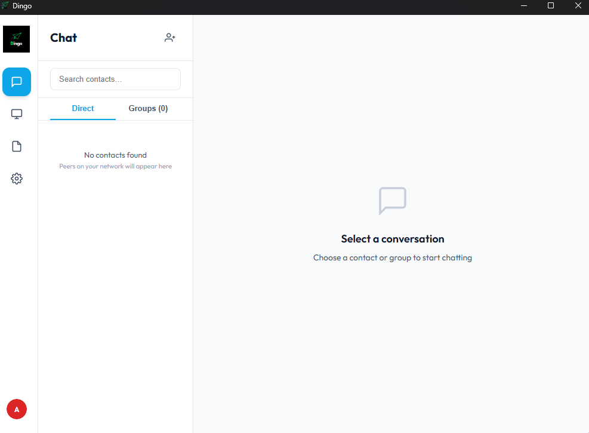
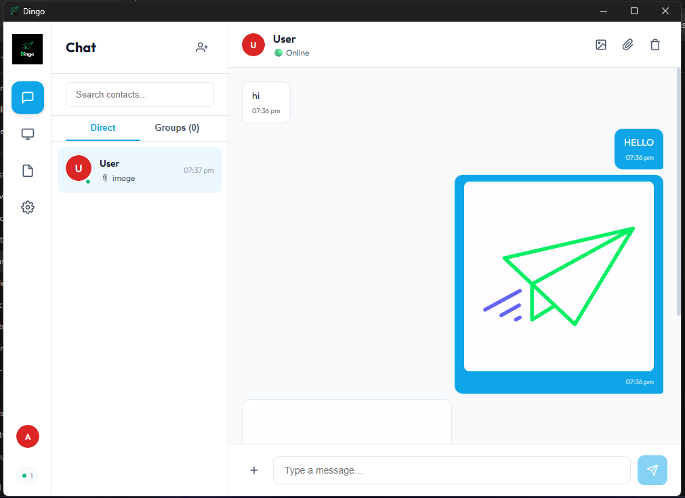

<div align="center">
  
  <p><strong>Next-Generation Peer-to-Peer Desktop Messaging & File Sharing</strong></p>
  <p>
    <a href="https://github.com/Abhranil2004/DINGO---P2P-Desktop-Messaging-Application/releases">
      
    </a>
    <a href="LICENSE">
      
    </a>
    
    
    
    
    
    
  </p>
</div>

---

**DINGO** is a fast, private, and secure peer-to-peer desktop messaging and file sharing application built with **Tauri v2, Rust, and React 19**. 

Dingo operates with a **Strict Zero-Knowledge P2P Architecture** — communication flows directly device-to-device with no central messaging servers, no cloud storage of chats, and no tracking.

---

## 🚀 Key Capabilities

### 1. Local Wi-Fi & LAN P2P
- **Automatic Peer Discovery** — Instant mDNS/UDP broadcast discovery on your local network.
- **Zero Configuration** — Launch Dingo and immediately see peers on your Wi-Fi.
- **Direct Encrypted Transfers** — Local HTTP & socket streaming for text, voice notes, and large files.

### 2. Global Long-Distance Mode (Internet P2P)
- **One-Click Internet Mode** — Toggle Long-Distance Mode on/off in Settings.
- **Global Dingo ID Discovery** — Connect with friends anywhere across the globe using their unique `@handle`.
- **Ephemeral Cloudflare Signaling** — Coordinated via lightweight Cloudflare Workers & Durable Objects WebSocket hibernation API.
- **Direct WebRTC DataChannels** — Direct encrypted device-to-device transport across NATs via STUN.
- **Strict Privacy Barrier** — Cloudflare **never** relays, stores, or inspects chat messages or file contents. All chats and files remain solely on your local PC.

### 3. Privacy & Security
- **End-to-End Encryption** — Cryptographic key exchange via X25519 and per-message AES-256-GCM.
- **Local SQLite Storage** — All conversations, contacts, and media files are stored locally on your device.
- **Zero Account Tracking** — No phone numbers, no email addresses, no tracking cookies.

### 4. Desktop Features
- **Native Screen Capture** — Share desktop regions or full screenshots instantly via Rust native bindings.
- **File & Media Transfer** — Chunked high-speed transfers with progress indicators.
- **Rich Neo-Brutalist UI** — Vivid aesthetics, sharp borders, high-contrast themes (Light & Dark), and floating notifications.
- **Integrated Notes** — Built-in local scratchpad and note-taking system.

---

## 📸 Screenshots

<div align="center">
  
  
</div>

---

## 🛠 Tech Stack

| Layer | Technology |
|---|---|
| **Desktop Core** | [Tauri v2](https://v2.tauri.app/), [Rust](https://www.rust-lang.org/) |
| **Frontend** | [React 19](https://react.dev/), [Vite 7](https://vitejs.dev/), [React Router](https://reactrouter.com/) |
| **Styling** | Neo-Brutalist CSS System (Responsive Dark/Light mode, custom Outfit typography) |
| **Local Database** | SQLite via `rusqlite` |
| **Cryptography** | `x25519-dalek` (X25519 key exchange), `aes-gcm` (AES-256-GCM message encryption) |
| **Signaling & Discovery** | Cloudflare Workers, Cloudflare Durable Objects (SQLite backend) |
| **P2P Transport** | WebRTC DataChannels (Internet P2P), Local UDP & HTTP (LAN) |

---

## 📥 Downloads & Installation

### Windows Desktop Build (v1.0.1)

You can find ready-to-run Windows executables directly in the project root:

- **Setup Installer**: [`Dingo_1.0.1_x64-setup.exe`](Dingo_1.0.1_x64-setup.exe) *(Installs DINGO with Start Menu & Desktop shortcuts)*
- **Standalone Portable**: [`Dingo.exe`](Dingo.exe) *(Run directly without installation)*

---

## 💻 Development & Building from Source

### Prerequisites

- **Node.js** 18+ & **pnpm** (`npm install -g pnpm`)
- **Rust** stable (install via [rustup.rs](https://rustup.rs))
- **Windows Build Tools** (Visual Studio C++ build tools & WebView2 runtime)

### Quick Start

```bash
# Clone the repository
git clone https://github.com/Abhranil2004/DINGO---P2P-Desktop-Messaging-Application.git
cd "DINGO – P2P Desktop Messaging Application"

# Install frontend dependencies
pnpm install

# Start in development mode with hot reload
pnpm tauri dev
```

### Production Build

```bash
# Compile and package Windows installer & executable
pnpm tauri build --bundles nsis
```

The output files will be created at:
- `src-tauri/target/release/dingo.exe`
- `src-tauri/target/release/bundle/nsis/Dingo_1.0.1_x64-setup.exe`

---

## 🌐 Cloudflare Signaling Server (`dingo-signaling/`)

DINGO uses a serverless signaling coordinator for NAT traversal and ephemeral presence:

```bash
cd dingo-signaling
npm install

# Run automated tests
npm test

# Deploy to Cloudflare Workers
npx wrangler deploy
```

---

## 📂 Project Structure

```
DINGO/
├── src/                          # React 19 Frontend
│   ├── components/               # UI components (Aside, LongDistanceP2PSection, etc.)
│   ├── context/                  # App state and user context
│   ├── hooks/                    # Custom React hooks
│   ├── lib/                      # P2P WebRTC engine & Tauri IPC
│   │   └── p2p/                  # P2PManager, WebRTC connection lifecycle, presence
│   └── pages/                    # Chat, Notes, Settings
├── src-tauri/                    # Rust Backend & Tauri bindings
│   ├── src/
│   │   ├── commands.rs           # Native Tauri commands (DB, profile, files, screen)
│   │   ├── crypto.rs             # X25519 key exchange & AES-GCM
│   │   ├── db.rs                 # SQLite schema & persistence
│   │   ├── discovery.rs          # UDP LAN broadcast peer discovery
│   │   ├── file_server.rs        # HTTP streaming file server
│   │   └── screen_capture.rs     # Native screen capture
│   └── tauri.conf.json           # Tauri bundle & permissions configuration
├── dingo-signaling/              # Cloudflare Workers & Durable Objects
│   ├── src/
│   │   ├── index.ts              # Worker routing & health check
│   │   ├── signaling-room.ts     # Ephemeral 2-peer WebRTC offer/answer room
│   │   └── presence-registry.ts  # Temporary online presence for Dingo IDs
│   └── wrangler.jsonc            # Cloudflare deployment config
├── public/                       # Assets & new brand logos
│   ├── dingo-banner.png          # DINGO banner logo
│   └── dingo-horizontal.png      # Horizontal application logo
├── Dingo_1.0.1_x64-setup.exe     # Windows setup installer
└── Dingo.exe                     # Standalone Windows executable
```

---

## 📄 License

Distributed under the MIT License. See `LICENSE` for details.

<div align="center">
  <p>Crafted with ❤️ by <a href="https://github.com/Abhranil2004"><strong>Abhranil Dutta</strong></a></p>
</div>
